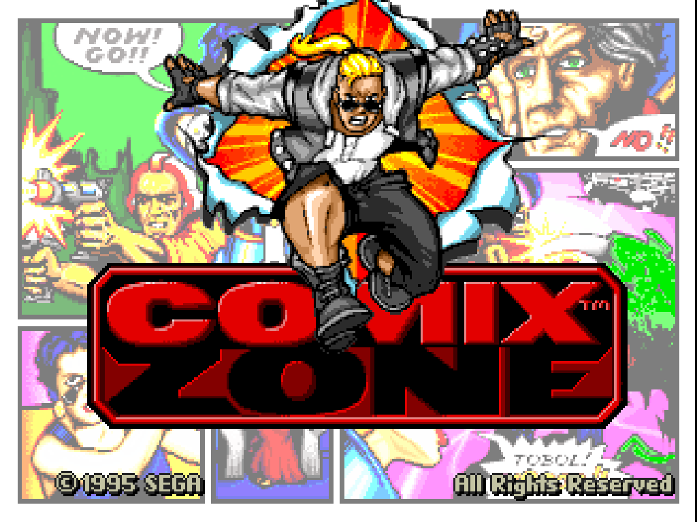
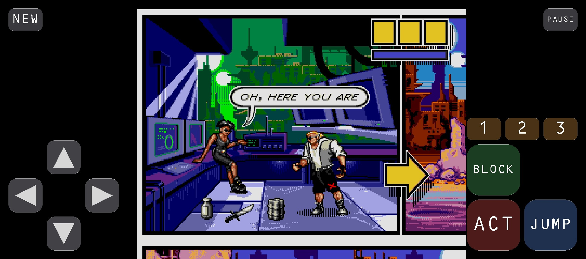
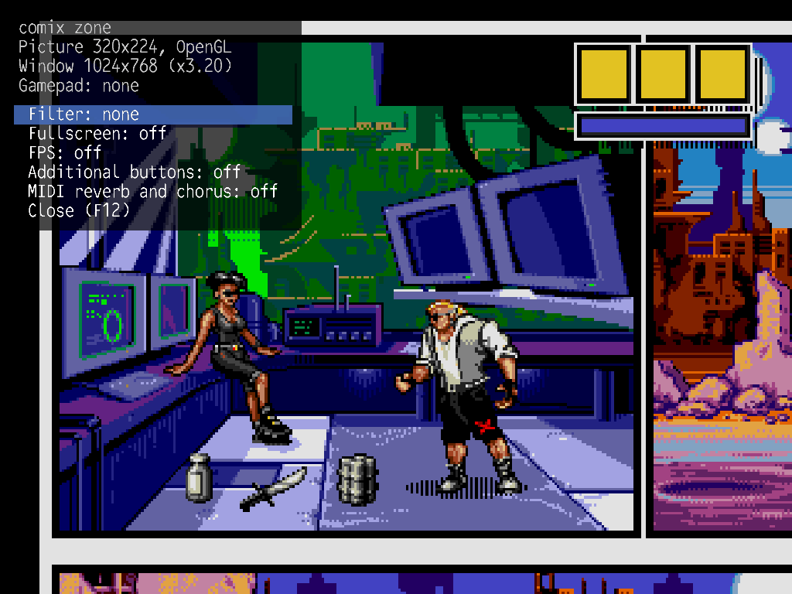

# Comix Zone — a native port by static recompilation

A native port of the Windows 95 version of *Comix Zone* to Linux, Windows and Android. The
original `COMIX.EXE` is statically recompiled with [SR](https://github.com/M-HT/SR): every
instruction of the game becomes native code, and the game runs its own logic as it did in
Windows 95. What Windows, WinG and the Miles Sound System gave it comes from the port's
runtime, [SR-SDK](SR-SDK/README.md), on SDL2.

No game data is included. The build and the game need your own copy of the game's CD.



## The original

| | |
|---|---|
| Game | *Comix Zone*, a side-scrolling beat 'em up set inside the pages of a comic book |
| Developer, publisher | Sega (Sega Technical Institute made the Mega Drive original, 1995) |
| Year | 1996, the Windows 95 version |
| Platform | Windows 95, CD-ROM |
| Executable | `COMIX.EXE`, a PE32 GUI program: Microsoft Visual C++ |
| Graphics | WinG (`WING32.DLL`): a 256-colour picture, blitted to a GDI window |
| Sound | the Miles Sound System (`WAIL32.DLL`): digital samples |
| Music | XMIDI sequences, played by Miles on the MIDI device |
| Input | keyboard (`GetAsyncKeyState`), joystick; the window menu with its dialogs |

### Why this version

The Windows 95 version is a piece of history of its own, not a copy of the Mega Drive game:

- **The music is MIDI.** The Mega Drive plays its music on its FM sound chip; the PC
  version has the score as XMIDI sequences, played by Miles on a General MIDI
  synthesizer: the same tunes, arranged for other instruments.
- **The sound effects are better samples.** The punches, the voices and the rest of the
  sounds are digital samples of a higher quality than the cartridge could hold.
- **WinG.** The game draws through WinG, Microsoft's short-lived API of 1994 for fast
  graphics on Windows 3.1 and Windows 95, made before DirectX and dropped soon after: few
  games used it, and today's Windows no longer has it.
- **Its own title menu.** The title screen has the menu of the game's window: Game
  (Start, Difficulty), Mode (Full Screen or Window), Options (music, sound effects,
  Setup Keyboard, Setup Gamepad, the language of the menus) and Help, with its dialogs.

## How the port works

- **Recompilation.** SR's Win32 recompiler (SRW) translates `COMIX.EXE` into llasm, an
  intermediate language. SR-SDK lowers it to LLVM IR, and LLVM compiles it for x86-64 and
  arm64. The game's data stays at the addresses it had in Windows 95
  (`guest_data_in_memory=yes` in `game/game.cfg`).
- **Win32 runtime** (SR-SDK `runtime/win32`): the windows and messages, GDI, the file
  system, the registry, the menu bar of the window and the game's dialogs (Setup
  Keyboard, Setup Gamepad, About), drawn over the picture.
- **WinG** (`game/WinApi-wing.c`): the game's device context and its palette-indexed
  bitmap are the port's own; the picture goes to an SDL window, through OpenGL when a
  filter is chosen.
- **Miles** (SR-SDK's `WinApi-wail32.c`, `GAME_WINAPI_WAIL32`): the sample handles play
  through SDL_mixer. The XMIDI music is turned into MIDI and played by SR-SDK's
  synthesizer (TinySoundFont) with a General MIDI bank, `soundfont.sf2` of the game
  directory: the build cuts FluidR3_GM, installed on its system, to the presets of the
  game's music (`soundfont=` of `game/distrib.cfg`).

## What works

- The game plays: the menus, the levels, sound and music, the settings, saved in
  `COMIX.INI` as the original does.
- Linux (x86-64, arm64), Windows (x86-64; it also runs under Wine) and Android (arm64),
  with on-screen buttons and a touch on the top strip for the window menu.


- The window menu (Full Screen or Window, the settings dialogs), and Esc switching the
  mode as in the original.
- The port's panel (F12): the size of the picture, the window or the full screen, the
  frame rate, the gamepad, and the port's settings, saved at once in `comix-zone.cfg`.
- Gamepads, through SDL's game controller support.

## Mods

By default the port looks and plays as the original. A mod is a key of `comix-zone.cfg`,
off by default, switched in the panel too.



| Key | What it does |
|---|---|
| `Display_Shader` | a filter of the picture, through OpenGL: `smooth` (sharp bilinear), `pixelart` (Scale2x), `scanlines`, `crt`, `xbr` (xBR: smooth edges of lines and shapes), `super-xbr` (Super-xBR: the picture at twice its size, smoothed) |
| `Additional_Buttons` | Block on a third button of the joystick and on a key: button 3 (X of a pad) has the action `[JoyStick] button3` of `COMIX.INI` (Block by default), set also in the game's Set up Gamepad, and Block has a key, `[Keys] block` (C by default), set also in its Set up Keyboard; the game's own menu gives actions to two buttons only, its keys have no Block, and its Set up Gamepad swaps the names of Block and down (they are right with the mod); on Android the on-screen buttons get BLOCK, above ACT; also the panel's item "Additional buttons" |
| `Midi_Effects` | reverb and chorus on the MIDI music, as a General MIDI synthesizer (and fluidsynth) has them: the port's synthesizer has none; also the panel's item "MIDI reverb and chorus" |

## Building

Requirements: Python 3, SCons, GCC or Clang, LLVM's `opt` and `llc`, SDL2 and SDL2_mixer;
FluidR3_GM, the package `fluid-soundfont-gm` (`soundfont-fluid` on Arch), for the music; MinGW-w64 for Windows; the Android SDK and NDK for Android (see
[SR-SDK's README](SR-SDK/README.md#requirements)).

The recompiler reads `COMIX.EXE` from the CD, so the image is needed for the build as well.
Put it where `image=` of [`game/distrib.cfg`](game/distrib.cfg) points, beside the
repository: `../iso/Comix.bin` (with its `Comix.cue`). The build checks the executable
against the SHA-256 in `game/recomp/`.

```sh
git clone --recursive <this repository>
cd comix_zone-recomp
make linux      # build/bin/x64-linux/comix-zone-x64
make windows    # MinGW-w64 cross build, with the SDL DLLs
make apk        # Android, arm64
make distrib    # the release archives, in build/distrib/
```

## Running

```sh
./run-sdl.sh            # the Linux build
./run-sdl-wine.sh       # the Windows build under Wine
./run-orig-wine.sh      # the original COMIX.EXE under Wine, for comparison
```

The launchers run the game on `build/distrib/data`: the game directory as the game's
installer makes it, made from the image by `make distrib-data`. The port writes into
`build/run`.

A release archive (`make distrib`) holds the program and that game directory; its
`readme-*.txt` and `comix-zone.cfg` describe the settings and the environment variables.

## License

The code of this repository is under the MIT license, as its file headers say. SR-SDK
and SR are under the MIT license as well: see `SR-SDK/LICENSE` and `SR-SDK/NOTICE.md`.
SR is by Roman Pauer; this port stands on it. The sound bank, which the build makes, is
FluidR3_GM by Frank Wen, under the MIT license (`soundfont.LICENSE` beside it).

*Comix Zone* itself, its executable and its data belong to their owners and are not part
of this repository.
